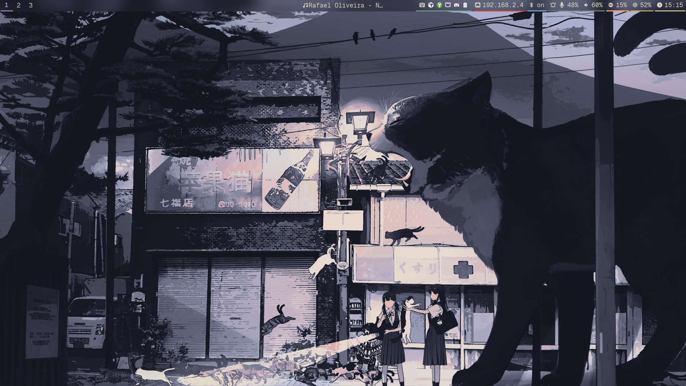
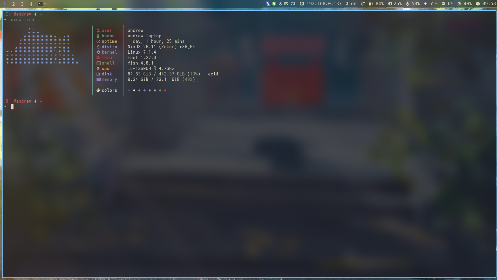

# Andrewix — NixOS + Home Manager Config

Personal NixOS + Home Manager config using flake-parts with dendritic architecture.

## Quick Start

```bash
just switch <host>        # Apply config
just test <host>          # Validate (requires sudo)
just check                # Eval errors
just update               # Update flake inputs (commits lock)
just fmt && just lint     # Format + lint
```

Hosts: `andrew-laptop`, `andrew-pc`, `andrew-home-wsl`, `andrew-work-wsl`. Default host auto-detected via `hostname -s`.

### No Justfile?

```bash
nix run .#<host> -- switch
nix run .#<host> -- test
nix flake check
nix flake update --flake .
alejandra . && statix check && deadnix --no-underscore --fail
```

## Fresh Install

Provisions disks declaratively via [disko](https://github.com/nix-community/disko) — no manual partitioning.
`andrew-laptop` = one disk (ESP + swap + xfs root). `andrew-pc` = three (`nixos` ESP/swap/xfs, `works` btrfs
`/works`, `entertainment` xfs `/entertainment`). disko owns `fileSystems`/`swapDevices`, so there is nothing to edit
by hand before installing.

1. Boot the NixOS minimal ISO and connect to the network (`nmtui`).

1. Clone the repo and run the guided installer — it reads the disk roles from the flake and asks you to pick a device
   for each (`gum` is pulled in automatically on the stock ISO):

   ```bash
   git clone https://github.com/hoanhxlyn/andrewix ~/andrewix
   ~/andrewix/install.sh
   ```

   Non-interactive equivalent (laptop shown; `andrew-pc` also needs `--disk works <dev> --disk entertainment <dev>`):

   ```bash
   sudo nix --experimental-features "nix-command flakes" run \
     github:nix-community/disko/latest#disko-install -- \
     --flake github:hoanhxlyn/andrewix#andrew-laptop --disk main /dev/nvme0n1
   ```

1. Reboot. Log in as `andrew` / `admin123`, then:

   ```bash
   passwd                                    # change the bootstrap password
   # copy the shared age key so secrets decrypt (see Secrets below):
   #   ~/.config/sops-nix/keys.txt
   ```

Only `andrew-laptop` / `andrew-pc` are installable (WSL hosts have no disk layout).

## Architecture

| Path                   | Purpose                            |
| ---------------------- | ---------------------------------- |
| `modules/core/`        | All aspects (NixOS + Home Manager) |
| `modules/devices/`     | Per-device aspects (laptop, wsl)   |
| `modules/defaults.nix` | Default includes for all hosts     |
| `modules/hosts.nix`    | Host definitions                   |
| `secrets/`             | sops-nix encrypted secrets         |
| `config/`              | Non-Nix app configs                |
| `flake.nix`            | **Auto-generated. DO NOT EDIT.**   |

Aspects auto-discovered. Compose via `den.aspects.<name>.includes` with angle-bracket imports (`<core/sound>`,
`<core/shell>`).

## Garbage Collection

```bash
just gc        # User store
just clean-up  # System-wide + delete old gens (sudo)
```

## Secrets

Encrypted with [sops-nix](https://github.com/Mic92/sops-nix) using a shared age key. Only available on workstation hosts
(`andrew-laptop`, `andrew-pc`) — not WSL.

- **Encrypted file:** `secrets/secrets.yaml` (safe to commit)
- **Age key location:** `~/.config/sops-nix/keys.txt` on each host
- **Edit secrets:** `sops secrets/secrets.yaml`
- **Setup new host:** copy the shared age private key to `~/.config/sops-nix/keys.txt`
- **Add a new secret:** edit `secrets/secrets.yaml` (via `sops`) then declare it in
  `modules/core/services/sync/sops.nix` under `sops.secrets`

## More

See `AGENTS.md` for conventions, module patterns, and rules.

## Galerry




